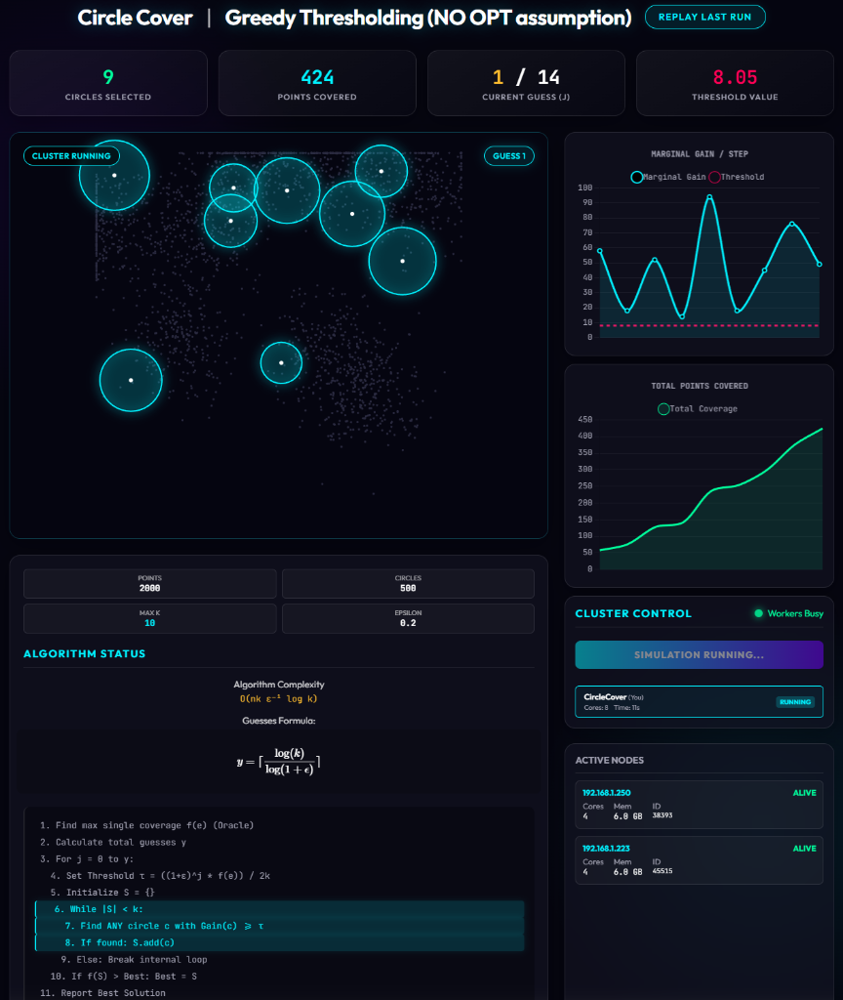

# Circle Cover Problem - PySpark Implementation

Distributed algorithms for the circle cover problem, implemented with Apache Spark and run on a Raspberry Pi cluster. The project contains two implementations:

- **`main.py`**: sequential greedy thresholding with a **1/2(1-ε) approximation guarantee**, with each greedy step parallelized over Spark. It is wired to the visualization dashboard.
- **`alg.py`**: the MapReduce algorithms from Liu & Vondrák, [*Submodular Optimization in the MapReduce Model*](https://arxiv.org/abs/1810.01489) (SOSA 2019), which need only a constant number of rounds.

## Algorithm

The circle cover problem is a geometric variant of set cover: given a set of points P and candidate circles C, find k circles that cover the maximum number of points. The coverage function is monotone submodular, so submodular maximization algorithms apply.

### Greedy thresholding (`main.py`)

- **Greedy thresholding** with logarithmic guesses for unknown OPT
- **PySpark** for parallelizing marginal gain computation
- Every greedy step is a separate Spark job, so a run takes roughly k · log(k) / ε rounds

### MapReduce algorithms from the paper (`alg.py`)

| Algorithm | Paper | Rounds | Approximation |
|-----------|-------|--------|---------------|
| Algorithm 6 (dense inputs) | Appendix A | 2 | 1/2 - ε on dense inputs |
| Algorithm 7 (sparse inputs) | Appendix A | 2 | 1/2 - ε on sparse inputs |
| **Theorem 8** (Algorithms 6 + 7, best of both) | Appendix A | 2 | **1/2 - ε** on all inputs |
| **Algorithm 5** (t thresholds, unknown OPT) | Section 2.2 | 2t + 2 | **1 - (1 - 1/(t+1))^t** (→ 1 - 1/e) |

All of them build on Algorithm 1 (ThresholdGreedy), Algorithm 2 (ThresholdFilter) and Algorithm 3 (PartitionAndSample).

- **Algorithm 6:** samples about 4√(nk) circles. Each partition builds a greedy solution from the sample and keeps only its own circles that still pass the threshold. A central greedy then runs over the survivors.
- **Algorithm 7:** each partition sends its 2k circles with the highest single-circle coverage to the central machine, which runs threshold greedy on them.
- **Theorem 8:** runs Algorithms 6 and 7 and returns the better solution. Here they run as two separate sets of Spark jobs rather than sharing the same 2 rounds.
- **Algorithm 5:** handles unknown OPT with the two extra rounds described in Section 2.2:
  - an initial round finds the best single circle, which bounds OPT within a factor of k
  - every OPT estimate runs the t threshold rounds in parallel
  - a final round picks the best solution

  The paper's omitted trick that reduces this to 2t rounds is not implemented.

| t | Rounds | Approximation |
|---|--------|---------------|
| 1 | 4 | 0.500 |
| 2 | 6 | 0.556 |
| 3 | 8 | 0.578 |



## Quick Start

### Local Mode (Windows/Linux)

```bash
# Create virtual environment
python -m venv .venv
.venv/Scripts/activate  # Windows
source .venv/bin/activate  # Linux

# Install dependencies
pip install -r requirements.txt

# Run locally with small dataset
python main.py --size small

# Run with visualization server (in separate terminals)
python viz_server.py  # Terminal 1
python main.py --ui-url http://localhost:8000 --size medium  # Terminal 2
python alg.py --ui-url http://localhost:8000 --size medium   # or the 2-round algorithm
# (or pick the algorithm and size in the UI and press "Run on cluster")

# Run the paper's 2-round algorithm (Theorem 8: Algorithms 6 + 7)
python alg.py --size small

# Run the paper's Algorithm 5 with t thresholds (2t + 2 rounds)
python alg.py --algorithm alg5 --t 3 --size small
```

### Cluster Mode (Raspberry Pi)

```bash
# SSH to master node
ssh pi@raspberrypi

# Run on cluster
~/spark-env/bin/python ~/main.py --cluster --size medium

# Run the paper's algorithms on the cluster
~/spark-env/bin/python ~/alg.py --cluster --size medium
~/spark-env/bin/python ~/alg.py --cluster --algorithm alg5 --t 2 --size medium
```

---

## Raspberry Pi Cluster

### Cluster Information

| Node | Role | IP | Cores | Memory |
|------|------|-----|-------|--------|
| raspberrypi | Master + Worker | 192.168.1.223 | 4 | 6GB |
| applepi | Worker | 192.168.1.250 | 4 | 6GB |

**Total Resources:** 8 cores, 12GB memory

### Web Interfaces

| Service | URL |
|---------|-----|
| Spark Master UI | http://raspberrypi:8080 |
| Spark Application UI | http://raspberrypi:4040 (when app running) |

### Cluster Management

#### Start Cluster
```bash
# Start master
ssh pi@raspberrypi "export JAVA_HOME=/usr/lib/jvm/java-21-openjdk-arm64 && ~/spark/sbin/start-master.sh"

# Start worker on raspberrypi
ssh pi@raspberrypi "export JAVA_HOME=/usr/lib/jvm/java-21-openjdk-arm64 && ~/spark/sbin/start-worker.sh spark://192.168.1.223:7077"

# Start worker on applepi
ssh pi@applepi "export JAVA_HOME=/usr/lib/jvm/java-21-openjdk-arm64 && ~/spark/sbin/start-worker.sh spark://192.168.1.223:7077"
```

#### Stop Cluster
```bash
# Stop all (from master)
ssh pi@raspberrypi "~/spark/sbin/stop-all.sh"

# Or stop individually
ssh pi@raspberrypi "~/spark/sbin/stop-worker.sh"
ssh pi@raspberrypi "~/spark/sbin/stop-master.sh"
ssh pi@applepi "~/spark/sbin/stop-worker.sh"
```

#### Check Status
```bash
# Check running Java processes
ssh pi@raspberrypi "jps"
ssh pi@applepi "jps"

# View logs
ssh pi@raspberrypi "tail -50 ~/spark/logs/spark-pi-org.apache.spark.deploy.master.Master-1-raspberrypi.out"
```

### Deploy Application

```bash
# Copy scripts to Pi
scp main.py pi@raspberrypi:~/main.py
scp alg.py pi@raspberrypi:~/alg.py
scp viz_client.py pi@raspberrypi:~/viz_client.py

# Run on cluster (without visualization)
ssh pi@raspberrypi "~/spark-env/bin/python ~/main.py --cluster --size medium"

# Run with visualization (requires viz_server running)
ssh pi@raspberrypi "~/spark-env/bin/python ~/main.py --cluster --ui-url http://127.0.0.1:8000 --size large"

# Or run directly from the UI dashboard (recommended)
# Navigate to http://raspberrypi:8000 and click "Run New Simulation"
```

### Visualization Dashboard

The project includes a real-time web visualization dashboard with interactive controls.

**Start the Server:**
```bash
ssh pi@raspberrypi
# Start the visualization server (runs on port 8000)
~/spark-env/bin/python ~/viz_server.py
```

**Run the Algorithm with Visualization:**
```bash
# In a separate terminal, run the algorithm with the --ui-url flag
ssh pi@raspberrypi "~/spark-env/bin/python ~/main.py --cluster --ui-url http://127.0.0.1:8000 --size medium"
```

**Access the UI:**
Open `http://raspberrypi:8000` in your browser.

**Features:**
- **Real-time Visualization**: See points and circles as they are covered during exploration.
- **Final Solution Highlighting**: Best solution circles rendered in **gold** with enhanced glow, distinguishing them from intermediate guesses (cyan).
- **Dataset Size Selection**: Choose from small (2K), medium (25K), or large (100K) point datasets.
- **Smart Sampling**: Automatic stratified/uniform sampling for large datasets to maintain UI performance.
- **Cluster Control**: Start new simulations directly from the UI with customizable dataset sizes.
- **Live Worker Stats**: Monitor core/memory usage of connected nodes in real-time.
- **Algorithm Metrics**: Track marginal gain and total coverage graphs across all guesses.

**What You'll See:**

The visualization progresses through multiple threshold guesses (j=0 to log k):
1. **Exploration phase** - Cyan circles appear as the algorithm tests different thresholds
2. **Final result** - Screen clears and the **best solution** is displayed in **gold**
3. Status shows: `FINAL SOLUTION: X% Coverage` with the winning guess number

---

## Configuration

### Dataset Size

Choose from three predefined configurations via command line:

```bash
# Small dataset (2K points, 500 circles, 8 clusters)
python main.py --size small

# Medium dataset (25K points, 2K circles, 20 clusters)
python main.py --size medium

# Large dataset (100K points, 5K circles, 50 clusters)
python main.py --size large
```

### Algorithm Parameters

Edit in `main.py` (applies to all sizes):

```python
K = 10              # Maximum circles to select
EPSILON = 0.2       # Approximation parameter (affects # of guesses)
BOUNDS = (0, 0, 1000, 1000)    # Spatial bounds
RADIUS_RANGE = (30, 100)        # Circle radius range
```

For `alg.py`, k = 10 and ε = 0.2 are set in `main()`. The command-line options are:

| Option | Values | Default |
|--------|--------|---------|
| `--size` | `small`, `medium`, `large` | `small` |
| `--cluster` | flag | off |
| `--algorithm` | `theorem8`, `alg5` | `theorem8` |
| `--t` | number of thresholds for Algorithm 5 | `2` |

### Cluster Settings

```python
SPARK_MASTER_URL = "spark://192.168.1.223:7077"
```

Or use `--cluster` flag to enable cluster mode (auto-detects Pi cluster environment).

---

## Project Structure

```
PI-Cluster/
├── main.py              # Greedy thresholding implementation (with visualization)
├── alg.py               # MapReduce algorithms from Liu & Vondrák (Algorithms 5, 6, 7, Theorem 8)
├── viz_server.py        # Visualization backend (FastAPI)
├── ui/                  # Frontend assets
│   ├── index.html       # Dashboard UI
│   ├── style.css        # Glassmorphism styles
│   └── script.js        # Visualization logic
├── requirements.txt     # Python dependencies
├── README.md            # This file
└── CLUSTER_SETUP.md     # Detailed cluster setup guide
```

---

## Requirements

### Local Development
- Python 3.11+
- Java 17+ (for Spark)
- See `requirements.txt`

### Raspberry Pi Cluster
- Raspberry Pi 5 (8GB RAM recommended)
- Raspberry Pi OS (Debian Trixie)
- Java 21
- Python 3.13

---

## References

- Paul Liu and Jan Vondrák. [Submodular Optimization in the MapReduce Model](https://arxiv.org/abs/1810.01489). SOSA 2019.
- [Apache Spark Documentation](https://spark.apache.org/docs/latest/)
- Submodular maximization for set cover problems
- Greedy thresholding algorithm with logarithmic guesses
