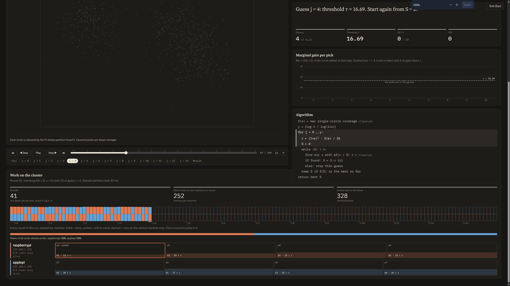
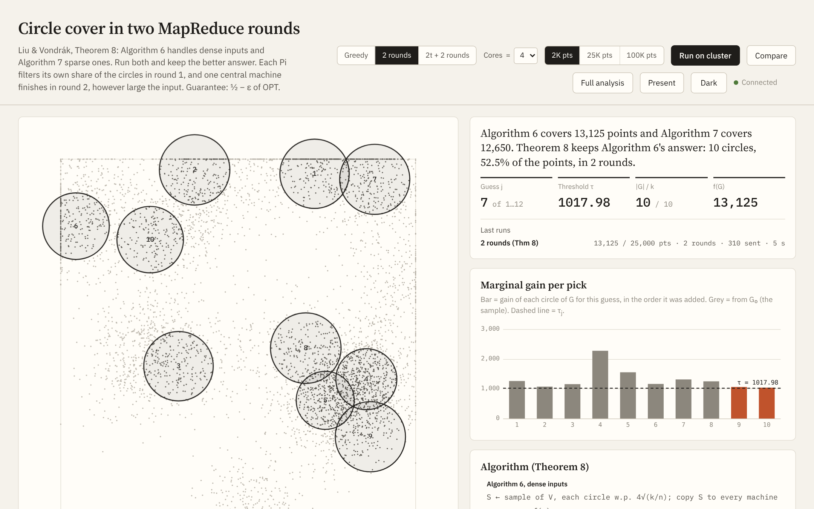
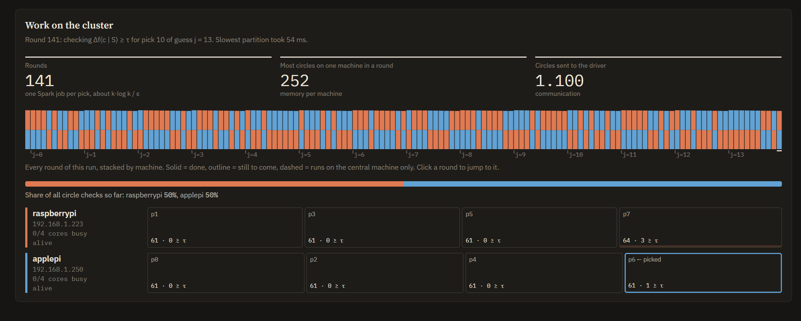
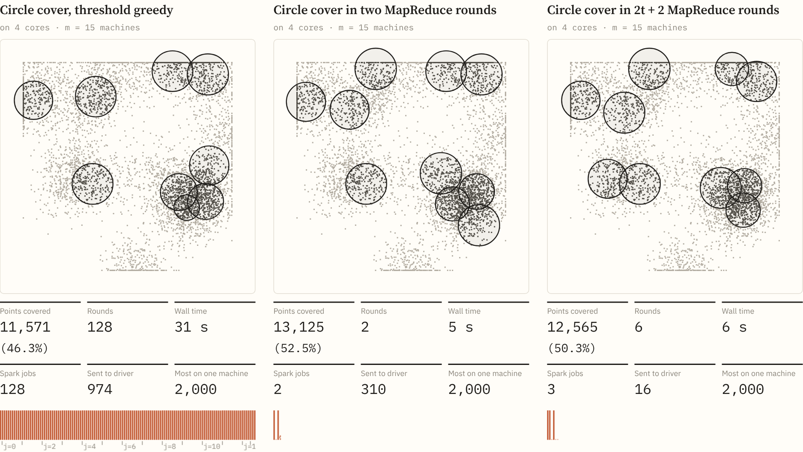
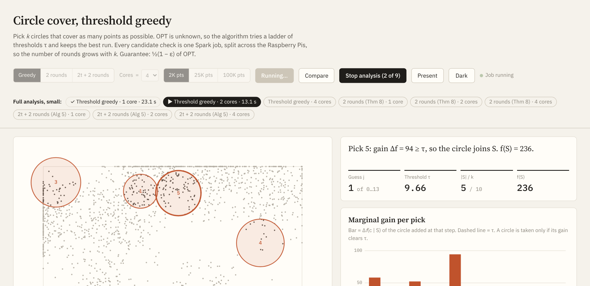
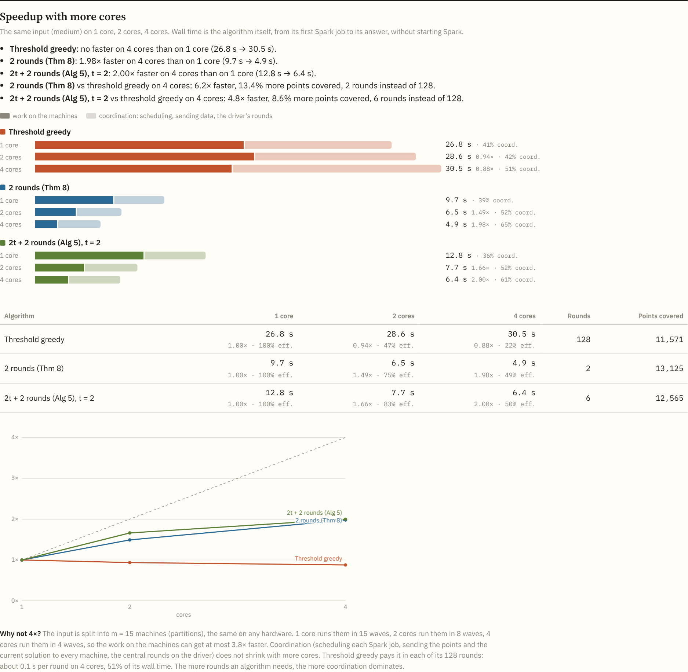

# Circle cover on a Raspberry Pi cluster

Distributed algorithms for the circle cover problem, written with Apache Spark and run on a Raspberry Pi cluster, with a live dashboard that shows how the work is split across the Pis. It is built for teaching: the dashboard steps through every round, shows each algorithm's pseudocode next to what it is doing, and compares algorithms and cluster sizes side by side.

`main.py` starts every run and picks the algorithm with `--algorithm`:

- **`greedy`** (default): sequential greedy thresholding with a **1/2(1-ε) approximation guarantee**. Each greedy step is parallelized over Spark, so a run needs many rounds.
- **`theorem8`** and **`alg5`**: the MapReduce algorithms from Liu & Vondrák, [*Submodular Optimization in the MapReduce Model*](https://arxiv.org/abs/1810.01489) (SOSA 2019), which need only a constant number of rounds.



## Algorithms

The circle cover problem is a geometric variant of set cover: given a set of points P and candidate circles C, find k circles that cover the maximum number of points. The coverage function is monotone submodular, so submodular maximization algorithms apply.

### Greedy thresholding (`algorithms/greedy.py`)

- **Greedy thresholding** with logarithmic guesses for unknown OPT
- **PySpark** for parallelizing marginal gain computation
- Every greedy step is a separate Spark job, so a run takes roughly k · log(k) / ε rounds

### MapReduce algorithms from the paper (`algorithms/`)

| Algorithm | Paper | Rounds | Approximation |
|-----------|-------|--------|---------------|
| Algorithm 6 (dense inputs) | Appendix A | 2 | 1/2 - ε on dense inputs |
| Algorithm 7 (sparse inputs) | Appendix A | 2 | 1/2 - ε on sparse inputs |
| **Theorem 8** (Algorithms 6 + 7, best of both) | Appendix A | 2 | **1/2 - ε** on all inputs |
| **Algorithm 5** (t thresholds, unknown OPT) | Section 2.2 | 2t + 2 | **1 - (1 - 1/(t+1))^t** (→ 1 - 1/e) |

All of them build on Algorithm 1 (ThresholdGreedy), Algorithm 2 (ThresholdFilter) and Algorithm 3 (PartitionAndSample).

- **Algorithm 6:** samples about 4√(nk) circles. Each partition builds a greedy solution from the sample and keeps only its own circles that still pass the threshold. A central greedy then runs over the survivors.
- **Algorithm 7:** each partition sends its 2k circles with the highest single-circle coverage to the central machine, which runs threshold greedy on them.
- **Theorem 8:** runs Algorithms 6 and 7 and returns the better solution. Here they run as two separate sets of Spark jobs rather than sharing the same 2 rounds.
- **Algorithm 5:** handles unknown OPT with the two extra rounds described in Section 2.2:
  - an initial round finds the best single circle, which bounds OPT within a factor of k
  - every OPT estimate runs the t threshold rounds in parallel
  - a final round picks the best solution

  The paper's omitted trick that reduces this to 2t rounds is not implemented.

| t | Rounds | Approximation |
|---|--------|---------------|
| 1 | 4 | 0.500 |
| 2 | 6 | 0.556 |
| 3 | 8 | 0.578 |

## The dashboard



- **Step through a run.** Every Spark round is an event on a timeline. Play, pause, step, scrub, or jump to a guess or round. The pseudocode highlights the line being executed.
- **See the work on the cluster.** Each round is drawn per Pi and per partition: how many circles each machine checked, what it sent to the driver, and which Pi found each chosen circle.

  

- **Compare algorithms.** *Compare* shows the latest run of each algorithm on the same input: coverage, rounds, wall time, Spark jobs, communication and the largest load on one machine.

  

- **Choose how many Pis.** The *Pis* picker in the header runs the next job on 1, 2, … all of the cluster's workers (*Cores* when running locally).
- **Full analysis.** Runs every algorithm on 1, 2, … N Pis, one run after another. While it runs, the run controls are locked (only *Stop analysis* works) and a queue under the header shows which runs are done, which one is running and what comes next.

  

  When it finishes, *Compare* gets a speedup section: a summary of what more hardware bought each algorithm and how the MapReduce algorithms compare with greedy, a bar per run split into work on the machines and coordination, a table with speedup, efficiency, rounds and coverage, and a short explanation of why the speedup is not linear. Every column finds the same solution, so the only thing that changes is the wall time.

  

  The paper's m machines are Spark partitions, with m = ⌈√(n/k)⌉ (8 for small, 15 for medium, 23 for large). m depends only on the input, not on the hardware, so adding Pis runs the same partitions side by side instead of one after another. The union of the machines' filtered circles is put back in machine order before the central greedy, so it does not depend on which Pi finishes first either. The threshold greedy barely speeds up: it needs one Spark job per pick (~130 rounds on medium), and each round pays a fixed coordination cost (scheduling the job, sending the current solution, collecting the answer) that more Pis do not shrink. The work part of each bar is the slowest machine per round, summed over the rounds; the rest of the wall time is coordination. That is the point the 2-round algorithms make.

- **Present mode** (P) for a projector, chapters ([ ] or PageUp/PageDown for clickers), and a light and dark theme.

## Quick start

### Local mode (Windows/macOS/Linux)

```bash
# Create virtual environment
python -m venv .venv
.venv/Scripts/activate  # Windows
source .venv/bin/activate  # Linux/macOS

# Install dependencies
pip install -r requirements.txt

# Run the threshold greedy on the small dataset
python main.py --size small

# The paper's 2-round algorithm (Theorem 8: Algorithms 6 + 7)
python main.py --algorithm theorem8 --size small

# The paper's Algorithm 5 with t thresholds (2t + 2 rounds), on 2 cores
python main.py --algorithm alg5 --t 3 --size small --cores 2

# With the dashboard (in separate terminals)
python viz_server.py                                          # Terminal 1, then open http://localhost:8000
python main.py --ui-url http://localhost:8000 --size medium   # Terminal 2
# (or pick the algorithm, size and cores in the dashboard and press "Run on cluster")
```

### Cluster mode (Raspberry Pi)

```bash
ssh pi@raspberrypi

# All alive workers
~/spark-env/bin/python ~/main.py --cluster --size medium
~/spark-env/bin/python ~/main.py --cluster --algorithm theorem8 --size large

# Only 2 of the Pis
~/spark-env/bin/python ~/main.py --cluster --algorithm alg5 --t 2 --size large --pis 2
```

With `--pis N`, the job asks the master for N × 4 cores in 4-core executors, so the master places them on N different Pis (it chooses which ones). The job waits up to 60 s for all of them to join before the first round.

### Command-line options

| Option | Values | Default |
|--------|--------|---------|
| `--algorithm` | `greedy`, `theorem8`, `alg5` | `greedy` |
| `--size` | `small` (2K points, 500 circles), `medium` (25K, 2,000), `large` (100K, 5,000) | `small` |
| `--t` | number of thresholds for Algorithm 5 | `2` |
| `--cluster` | flag: run on the Pi cluster instead of locally | off |
| `--pis` | cluster mode: number of Pis to run on | all alive workers |
| `--cores` | local mode: number of cores to run on | all |
| `--ui-url` | URL of the dashboard server | off |

---

## Raspberry Pi cluster

### Cluster Information

| Node | Role | IP | Cores | Memory |
|------|------|-----|-------|--------|
| raspberrypi | Master + Worker | 192.168.1.223 | 4 | 6GB |
| applepi | Worker | 192.168.1.250 | 4 | 6GB |

**Total Resources:** 8 cores, 12GB memory

### Web Interfaces

| Service | URL |
|---------|-----|
| Spark Master UI | http://raspberrypi:8080 |
| Spark Application UI | http://raspberrypi:4040 (when app running) |

### Cluster Management

#### Start Cluster
```bash
# Start master
ssh pi@raspberrypi "export JAVA_HOME=/usr/lib/jvm/java-21-openjdk-arm64 && ~/spark/sbin/start-master.sh"

# Start worker on raspberrypi
ssh pi@raspberrypi "export JAVA_HOME=/usr/lib/jvm/java-21-openjdk-arm64 && ~/spark/sbin/start-worker.sh spark://192.168.1.223:7077"

# Start worker on applepi
ssh pi@applepi "export JAVA_HOME=/usr/lib/jvm/java-21-openjdk-arm64 && ~/spark/sbin/start-worker.sh spark://192.168.1.223:7077"
```

#### Stop Cluster
```bash
# Stop all (from master)
ssh pi@raspberrypi "~/spark/sbin/stop-all.sh"

# Or stop individually
ssh pi@raspberrypi "~/spark/sbin/stop-worker.sh"
ssh pi@raspberrypi "~/spark/sbin/stop-master.sh"
ssh pi@applepi "~/spark/sbin/stop-worker.sh"
```

#### Check Status
```bash
# Check running Java processes
ssh pi@raspberrypi "jps"
ssh pi@applepi "jps"

# View logs
ssh pi@raspberrypi "tail -50 ~/spark/logs/spark-pi-org.apache.spark.deploy.master.Master-1-raspberrypi.out"
```

### Deploy

```bash
bash deploy.sh      # from Git Bash on Windows, or Linux/macOS
.\deploy.ps1        # or from PowerShell
```

The deploy scripts copy `main.py`, `data.py`, `oracle.py`, `viz_client.py`, `algorithms/`, `viz_server.py` and the dashboard to the master, then restart the dashboard server. Only the master needs the code: `main.py` zips its modules and ships them to the workers at start-up.

Then open `http://raspberrypi:8000`, pick an algorithm, a dataset size and the number of Pis, and press *Run on cluster*, or press *Full analysis*.

---

## Configuration

`main.py` (applies to all algorithms and sizes):

```python
K = 10              # Maximum circles to select
EPSILON = 0.2       # Approximation parameter (affects # of guesses)
SPARK_MASTER_URL = "spark://192.168.1.223:7077"
SPARK_MASTER_UI = "http://192.168.1.223:8080/json/"
CORES_PER_PI = 4
```

`data.py`:

```python
SIZE_CONFIGS = {...}            # points, circles and clusters per size
BOUNDS = (0, 0, 1000, 1000)     # Spatial bounds
RADIUS_RANGE = (30, 100)        # Circle radius range
```

To run on another cluster, change the master IP in `main.py`, the host in `deploy.sh`/`deploy.ps1`, and the venv path in `viz_server.py`. See [CLUSTER_SETUP.md](CLUSTER_SETUP.md) for setting up the Pis.

---

## Project structure

```
PI-Cluster/
├── main.py              # Start-up: command line, Spark, data, dashboard, runs the chosen algorithm
├── data.py              # Dataset sizes and point/circle generation
├── oracle.py            # Coverage oracle f(S)
├── algorithms/
│   ├── greedy.py        # Sequential threshold greedy
│   ├── building_blocks.py  # Algorithms 1, 2, 3 (ThresholdGreedy, ThresholdFilter, PartitionAndSample)
│   ├── alg5.py          # Algorithm 5 (t thresholds, 2t + 2 rounds)
│   ├── alg6.py          # Algorithm 6 (dense inputs, 2 rounds)
│   ├── alg7.py          # Algorithm 7 (sparse inputs, 2 rounds)
│   └── theorem8.py      # Theorem 8 (Algorithms 6 + 7)
├── viz_client.py        # Sends events to the dashboard server
├── viz_server.py        # Dashboard server (FastAPI): live events, runs, full analysis
├── ui/                  # Dashboard (index.html, style.css, script.js)
├── docs/                # Screenshots
├── deploy.sh, deploy.ps1   # Copy everything to the master and restart the dashboard
├── requirements.txt
└── CLUSTER_SETUP.md     # Setting up the Pis
```

---

## Requirements

### Local Development
- Python 3.11+
- Java 17+ (for Spark)
- See `requirements.txt`

### Raspberry Pi Cluster
- Raspberry Pi 5 (8GB RAM recommended)
- Raspberry Pi OS (Debian Trixie)
- Java 21
- Python 3.13

---

## References

- Paul Liu and Jan Vondrák. [Submodular Optimization in the MapReduce Model](https://arxiv.org/abs/1810.01489). SOSA 2019.
- [Apache Spark Documentation](https://spark.apache.org/docs/latest/)
- Submodular maximization for set cover problems
- Greedy thresholding algorithm with logarithmic guesses
